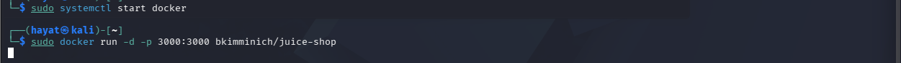
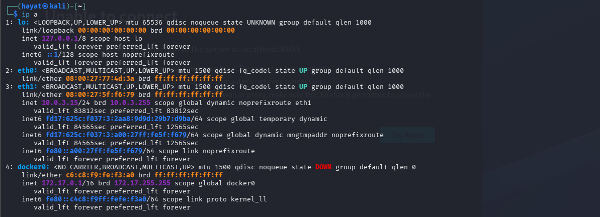
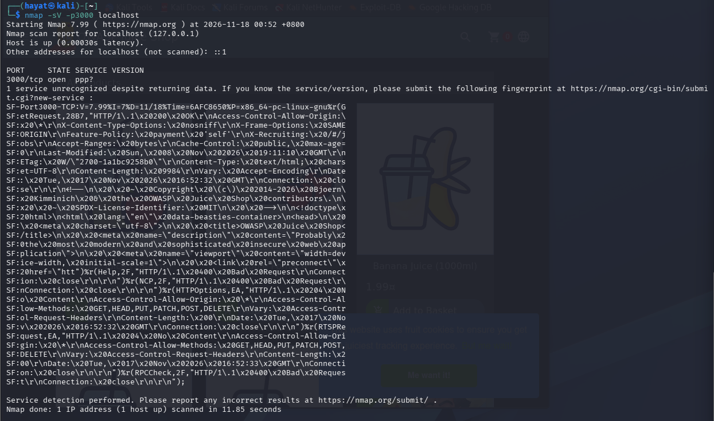
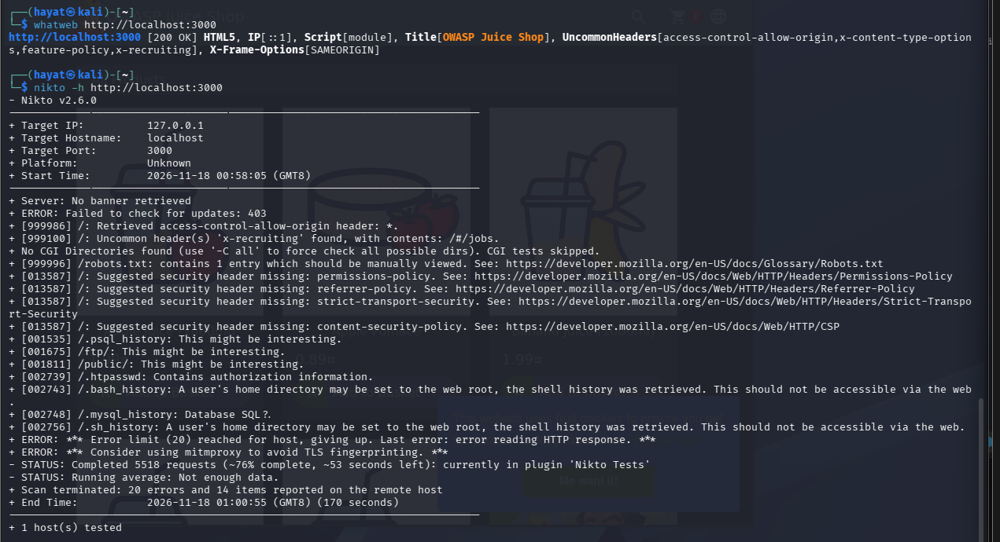
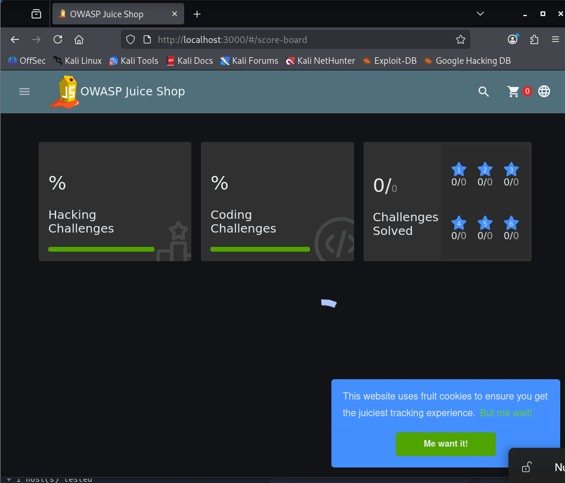
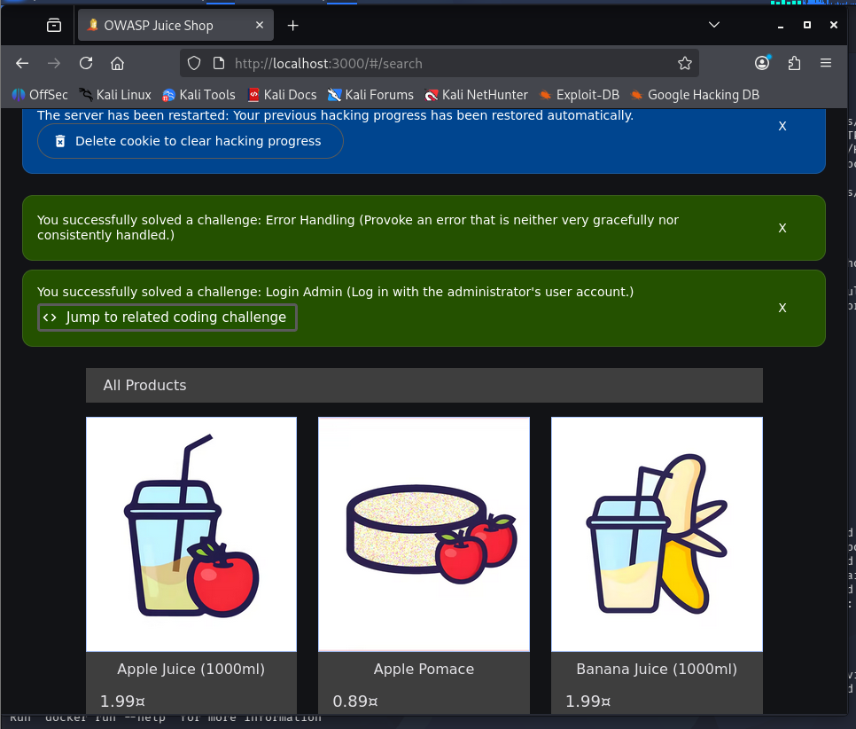
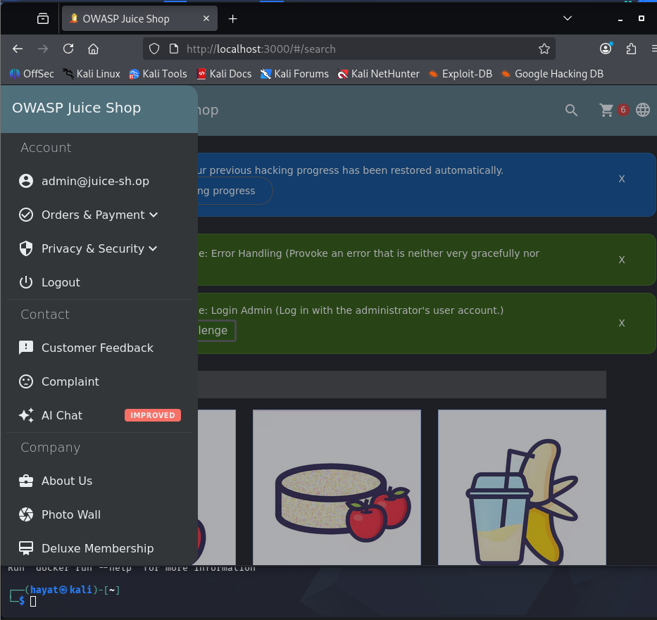
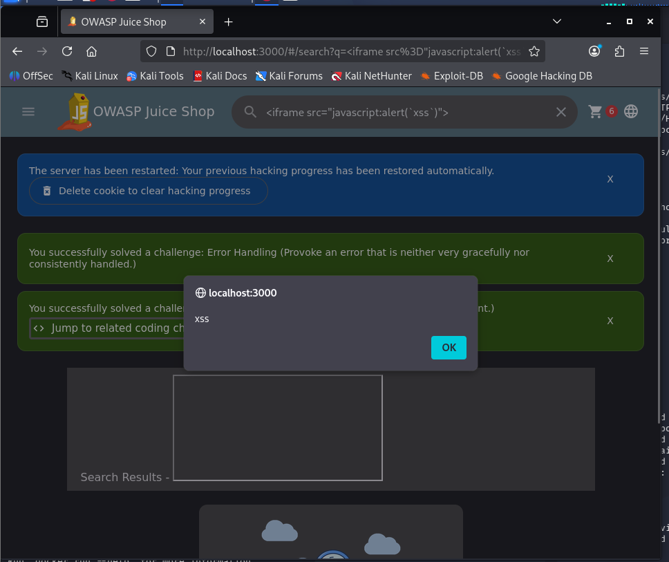
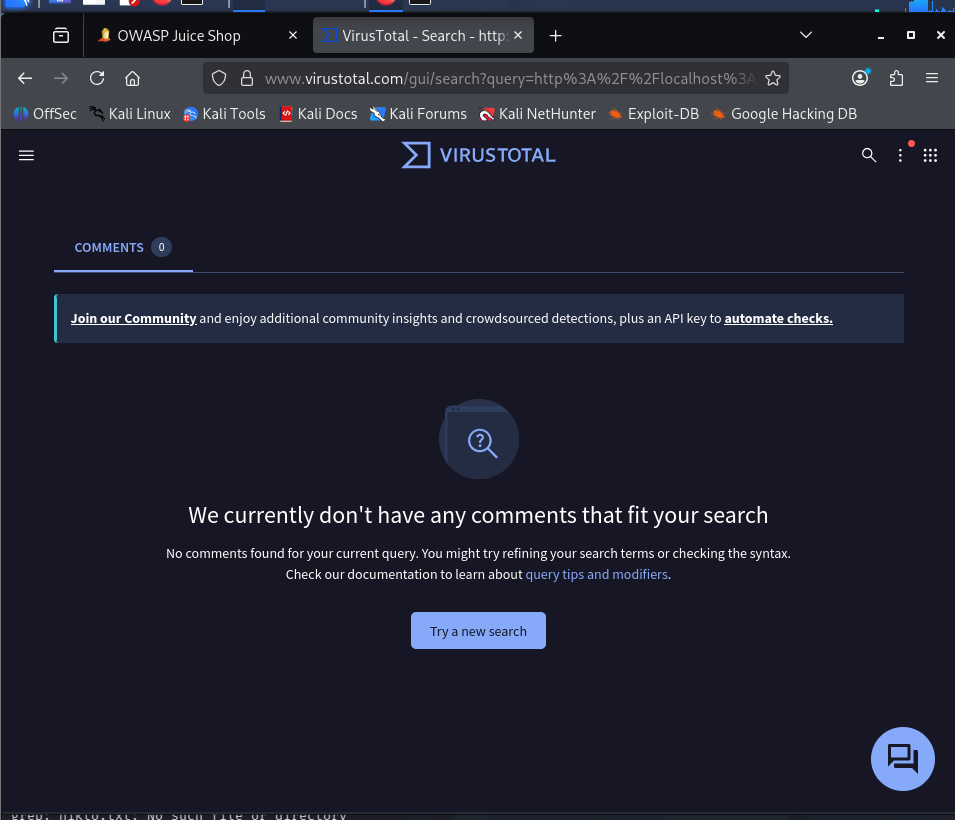
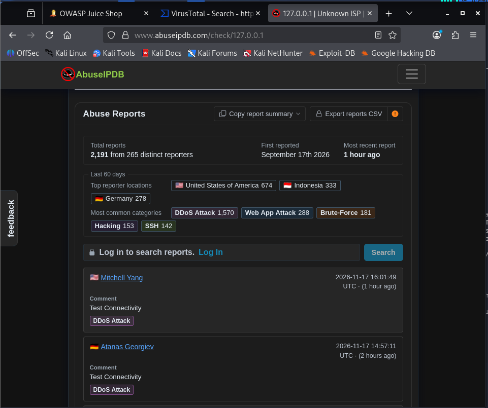

# Lab 4: Active Web Application Attack — OWASP Juice Shop

**Name:** _your name_
**Class:** _your class / student ID_
**Course:** IKB21403 Vulnerability Analysis
**Date:** 18 November 2026

> **Scope & ethics:** All testing was performed against a **deliberately vulnerable
> training application (OWASP Juice Shop)** running on an **isolated local lab** that I
> control. No real applications, websites, or third-party systems were targeted. Attack
> surface was limited to the web service (HTTP). This work is for educational purposes only.

---

## 1. Target Setup (Victim)

| Item | Detail |
|---|---|
| Application | OWASP Juice Shop (intentionally vulnerable web app) |
| Deployment | Docker container on the local machine |
| Command | `sudo docker run -d -p 3000:3000 bkimminich/juice-shop` |
| URL | `http://localhost:3000` |
| Target IP | `127.0.0.1` (localhost) |
| Open port | `3000/tcp` (HTTP) |



## 2. Own Host (Attacker)

| Item | Detail |
|---|---|
| OS | Kali Linux (VirtualBox VM) |
| Interface | `eth1` (NAT) |
| Attacker IP | `10.0.3.15` |



---

## 3. Reconnaissance & Scanning

### 3.1 Port & service scan (nmap)

```bash
nmap -sV -p3000 localhost
```

Port `3000/tcp` is **open**. The service banner returned an HTTP response identifying
the **OWASP Juice Shop** application (nmap could not fingerprint it to a standard
service name, but the raw banner clearly shows HTTP + Juice Shop).



### 3.2 Technology fingerprint (whatweb) & web scan (nikto)

```bash
whatweb http://localhost:3000
nikto -h http://localhost:3000 -o nikto.txt
```

- **whatweb:** HTML5, `Title[OWASP Juice Shop]`, `X-Frame-Options[SAMEORIGIN]`, and
  uncommon headers including `access-control-allow-origin` and `x-recruiting` (`/#/jobs`).
- **nikto:** multiple missing security headers and interesting exposed paths (see findings).



---

## 4. Findings, Evidence & Analysis

### Finding 1 — Hidden Score Board exposed (Broken Access Control)

| Field | Detail |
|---|---|
| Method | Direct URL access to an undocumented admin page |
| URL | `http://localhost:3000/#/score-board` |
| Observation | The internal "Score Board" page loaded without any authentication. |
| Interpretation | A sensitive internal page is reachable by any anonymous user. It does **not** prove full compromise, but shows the app fails to hide/guard internal routes. |
| Confidence | Confirmed (page rendered directly) |
| Limitation | This is an intentional challenge page; in a real app the impact depends on what the hidden page exposes. |
| Mitigation | Enforce authentication/authorization on internal routes; do not rely on "hidden" URLs for security. |



### Finding 2 — SQL Injection → Admin login bypass (Broken Authentication)

| Field | Detail |
|---|---|
| Method | SQL injection in the login form |
| Payload (Email) | `admin@juice-sh.op'--` |
| Password | any value (e.g. `test`) |
| Observation | Logged in as **admin@juice-sh.op** without the real password. Juice Shop confirmed the challenge *"Login Admin"* was solved. |
| Interpretation | The login query is built by string concatenation, so the `'--` comment truncates the password check. This is a critical authentication bypass. |
| Confidence | Confirmed (logged in as admin + success banner) |
| Limitation | Tested on a known-vulnerable app; the exact payload is app-specific. |
| Mitigation | Use **parameterized queries / prepared statements**; never concatenate user input into SQL; apply least-privilege DB accounts. |





### Finding 3 — DOM-based Cross-Site Scripting (XSS)

| Field | Detail |
|---|---|
| Method | Injected an iframe payload into the search field |
| Payload | `` <iframe src="javascript:alert(`xss`)"> `` |
| URL | `http://localhost:3000/#/search?q=...` |
| Observation | A JavaScript `alert("xss")` pop-up executed in the browser. |
| Interpretation | User input is written into the DOM without sanitisation/encoding, allowing arbitrary script execution. In a real app this could steal sessions/cookies or perform actions as the victim. |
| Confidence | Confirmed (alert pop-up fired) |
| Limitation | This is a reflected/DOM XSS in a controlled field; stored XSS was not tested. |
| Mitigation | Output-encode all user input; sanitise HTML; apply a strict **Content-Security-Policy**. |



### Finding 4 — Missing security headers (Security Misconfiguration)

| Field | Detail |
|---|---|
| Source | nikto |
| Observation | Missing headers: `Content-Security-Policy`, `Strict-Transport-Security`, `Referrer-Policy`, `Permissions-Policy`. |
| Interpretation | Absence of these headers increases exposure to XSS, clickjacking, and information leakage. Not an exploit by itself, but weakens defence-in-depth. |
| Confidence | Confirmed (reported by nikto) |
| Limitation | Header presence does not guarantee correct configuration; manual review still needed. |
| Mitigation | Add the missing response headers (CSP, HSTS, Referrer-Policy, Permissions-Policy). |

### Finding 5 — Permissive CORS & exposed paths (Information Disclosure)

| Field | Detail |
|---|---|
| Source | whatweb + nikto |
| Observation | `Access-Control-Allow-Origin: *` (any origin allowed); nikto flagged interesting paths such as `/ftp/`, `/public/`, and an `x-recruiting` header pointing to `/#/jobs`. |
| Interpretation | A wildcard CORS policy can allow other sites to read responses; exposed directories may leak files. These are leads, not proof of data loss. |
| Confidence | Inferred (needs manual verification of each path) |
| Limitation | nikto can produce false positives; `/ftp/` may be an intentional challenge folder. |
| Mitigation | Restrict CORS to trusted origins; remove/lock down exposed directories. |

---

## 5. Threat Intelligence / Reputation Check

### VirusTotal

Searched `http://localhost:3000` on VirusTotal — **no detections / no community data**.



*Interpretation:* `localhost` is not a public, internet-reachable host, so VirusTotal has
no scan data for it. This is **expected** for a local lab target and does **not** mean the
app is safe — it only means there is no public threat intel for a private address.

### AbuseIPDB

Checked `127.0.0.1` on AbuseIPDB — shows **2,191 reports** (categories: DDoS, Web App Attack, Brute-Force).



*Interpretation:* `127.0.0.1` is **everyone's own loopback address**, so these "reports" are
bogus/test submissions, not real intelligence about *my* target. This is a good reminder that
reputation tools must be read in context — a loopback or shared address gives **meaningless**
results. For a real public target, AbuseIPDB/VirusTotal would give useful reputation data.

---

## 6. Limitations

- Testing was limited to the **web layer (HTTP, port 3000)** of a single, intentionally
  vulnerable application in an isolated lab.
- Findings reflect point-in-time results; some scanner output (nikto) may contain false positives.
- Reputation tools (VirusTotal, AbuseIPDB) returned no meaningful data because the target is a
  **local/loopback address**, not a public host.
- No destructive actions (data deletion, DoS) were performed.

## 7. Conclusion

The OWASP Juice Shop target was successfully assessed at the web layer. Three vulnerabilities
were **confirmed by direct exploitation** — an exposed internal Score Board (broken access
control), a **SQL-injection admin-login bypass** (broken authentication), and a **DOM-based
XSS** — supported by scanner findings of missing security headers and a permissive CORS policy.
Each finding includes a recommended mitigation. All work was performed ethically against an
authorized, deliberately vulnerable lab target.
